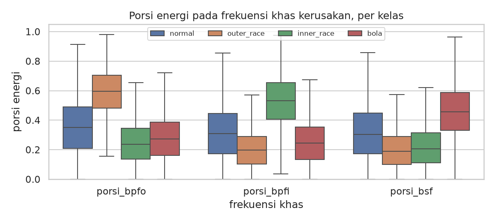
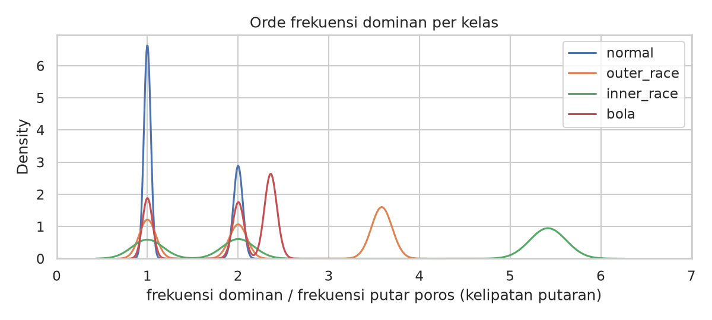
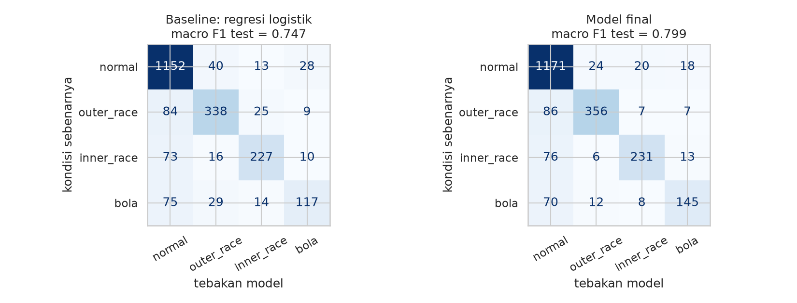
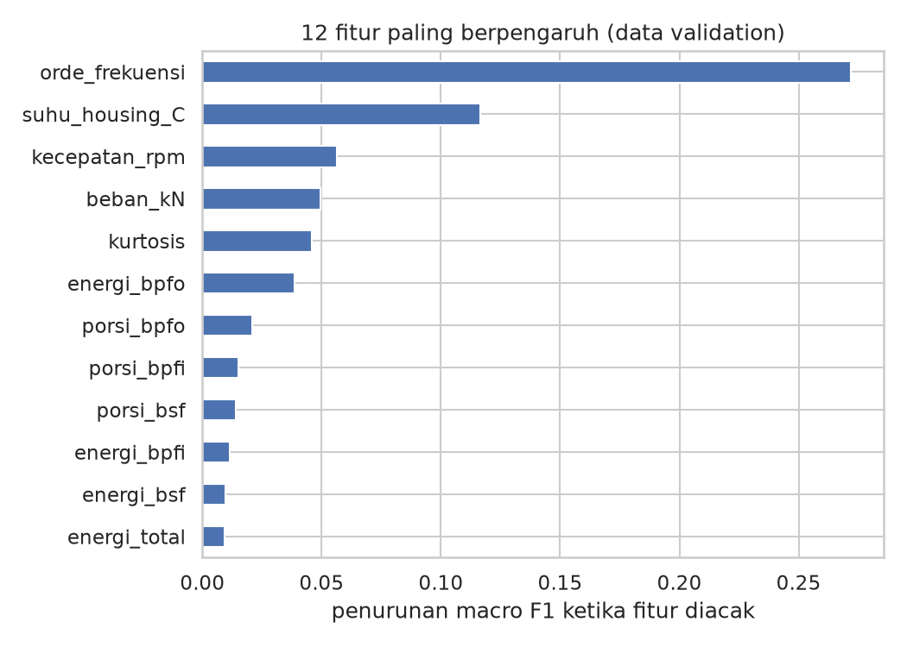
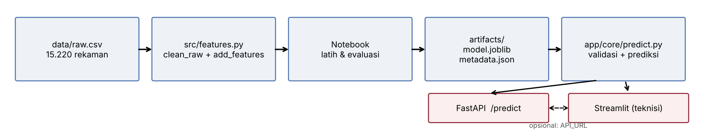
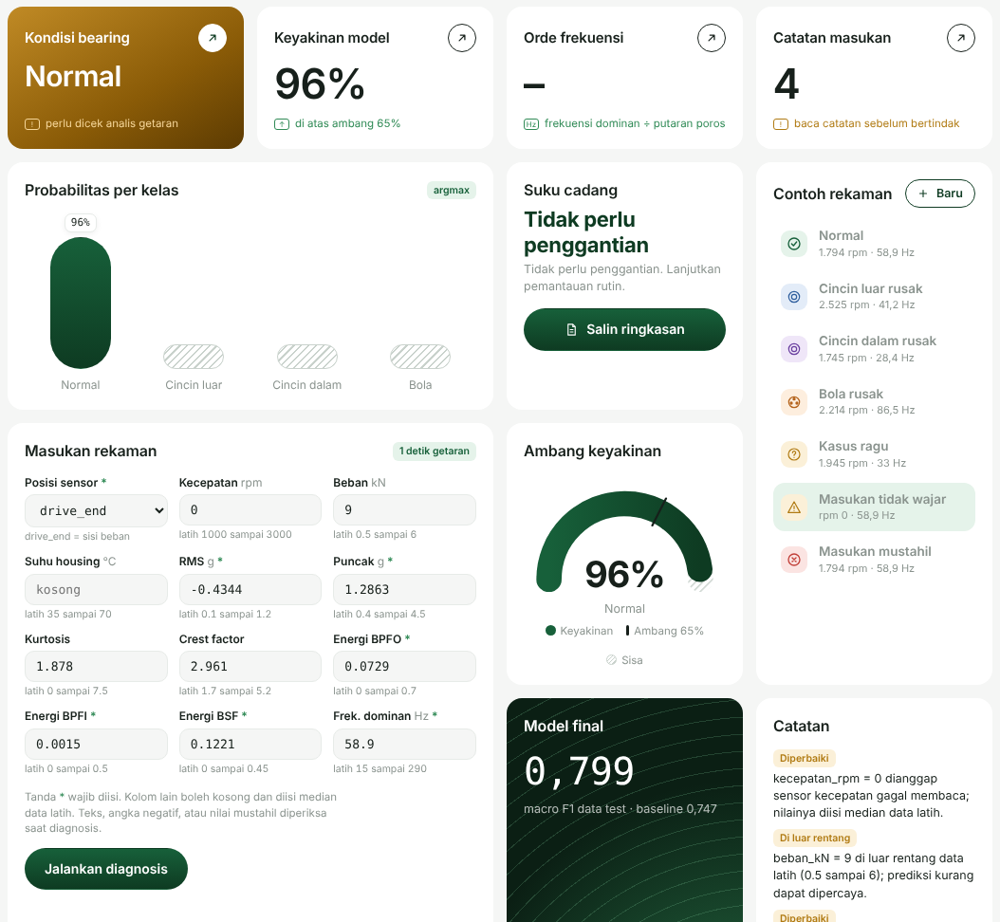
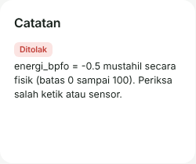

## 1. Masalah

Klien kami adalah analis getaran di sebuah pabrik semen. Ia rutin merekam getaran *bearing* motor dan pompa,
tetapi hanya dia yang bisa membaca spektrumnya, sementara rekamannya ribuan. Pengguna aplikasinya teknisi
pemeliharaan. Dari satu rekaman yang sudah diringkas menjadi angka, model menebak kondisi *bearing* (`normal`,
`outer_race`, `inner_race`, atau `bola`) supaya teknisi tahu suku cadang apa yang harus disiapkan sebelum
motor dibongkar.

Kekeliruan model punya dua akibat yang tidak sama beratnya. *Bearing* rusak yang ditebak normal tetap dipakai
sampai gagal dan bisa menghentikan produksi. *Bearing* normal yang ditebak rusak, atau jenis kerusakan yang
tertukar, hanya membuang waktu teknisi dan menyiapkan suku cadang yang salah. Karena itu aplikasi tidak hanya
memberi satu jawaban, tetapi juga menandai rekaman yang keyakinannya rendah agar tetap dicek analis.

Metrik utama dari *brief* adalah *macro* F1, yaitu rata-rata F1 keempat kelas dengan bobot sama. Metrik ini
cocok karena kelasnya tidak seimbang (`bola` hanya 10%) dan akurasi bisa terlihat tinggi hanya dengan sering
menebak `normal`. *Baseline* wajibnya regresi logistik multikelas dengan fitur asli.

## 2. Data

Data mentah berisi 15.220 rekaman berdurasi satu detik dengan 12 kolom masukan: posisi sensor (`drive_end`
atau `fan_end`), kecepatan putar, beban, suhu rumah *bearing*, RMS dan puncak getaran, kurtosis, *crest
factor*, energi getaran di tiga frekuensi khas kerusakan (BPFO untuk cincin luar, BPFI untuk cincin dalam,
BSF untuk bola), dan frekuensi dominan. Setelah dibersihkan tersisa 15.000 rekaman: `normal` 54,8%,
`outer_race` 20,3%, `inner_race` 14,5%, dan `bola` 10,4%.

| Masalah | Baris | Penanganan | Alasan |
|------------|---:|----------|------------|
| Duplikat persis | 220 | Dihapus sebelum data dibagi | Rekaman yang sama bisa masuk *train* dan *test* sekaligus |
| Label ditulis dalam 16 variasi (`NORMAL`, `ok`, `OR`, `BALL`, ...) | 915 | Dipetakan ke 4 kelas | Tanpa ini `OR` dan `outer_race` dianggap kelas berbeda |
| `kurtosis` kosong | 456 | Diisi median *train* (imputer di *pipeline*) | Kosongnya merata di semua kelas (sekitar 3%) |
| `suhu_housing_C` kosong | 153 | Diisi median *train* | Kosongnya merata di semua kelas (sekitar 1%) |
| `kecepatan_rpm` = 0 | 61 | Dijadikan kosong, lalu diisi median | Motor diam tidak mungkin punya frekuensi dominan puluhan Hz |
| `rms_g` negatif | 45 | Diambil nilai mutlak | `puncak_g / abs(rms_g)` tetap sama dengan `crest_factor` (selisih ≤ 0,0008) |

Imputasi sengaja diletakkan di dalam *pipeline*, sehingga median hanya dihitung dari data *train*.

Tiga temuan EDA paling berpengaruh pada model. Pertama, setiap jenis kerusakan menonjol di frekuensi khasnya:
porsi energi BPFO paling besar pada `outer_race`, BPFI pada `inner_race`, dan BSF pada `bola`, sedangkan
rekaman normal tersebar merata (Gambar 1). Kedua, jika frekuensi dominan dibagi frekuensi putar poros
(rpm/60), puncaknya mengumpul di kelipatan yang khas: normal di 1× dan 2×, `bola` di sekitar 2,3×,
`outer_race` di sekitar 3,6×, dan `inner_race` di sekitar 5,4× (Gambar 2). Sebagian rekaman rusak tetap
punya puncak di 1× atau 2×, dan di situlah model nanti paling sering keliru. Ketiga, kurtosis, *crest factor*,
dan suhu lebih tinggi pada ketiga kelas rusak (median suhu sekitar 3 °C di atas normal), tetapi rentangnya
tumpang tindih, sehingga fitur ini membantu memisahkan rusak dari normal, bukan membedakan jenis kerusakan.

<figure><figcaption>Gambar 1. Porsi energi di frekuensi khas, per kelas.</figcaption></figure>
<figure><figcaption>Gambar 2. Frekuensi dominan dalam kelipatan putaran poros.</figcaption></figure>

## 3. Metode

**Fitur.** Semua fitur dibuat oleh `src/features.py`, yang dipakai saat pelatihan dan saat prediksi di API
maupun aplikasi. Fitur turunannya:

- `orde_frekuensi` = frekuensi dominan / (rpm/60). BPFO, BPFI, dan BSF sebanding dengan kecepatan putar,
  jadi kelipatan putaran lebih stabil daripada frekuensi mentah ketika rpm berubah.
- `porsi_bpfo`, `porsi_bpfi`, `porsi_bsf`: energi tiap frekuensi khas dibagi total ketiganya, meniru cara
  analis membaca spektrum (frekuensi mana yang menonjol), tanpa ikut naik-turun dengan besar getaran.
- `energi_total`, `log_rasio_bpfo_bpfi`, dan `log_rasio_bsf_bpfi`.

**Pembagian data.** Acak *stratified* 70/15/15 (10.500 / 2.250 / 2.250) sesuai *brief*, dengan
`random_state=42`. Rekaman tidak berurutan waktu dan tidak punya identitas motor, jadi pembagian berdasarkan
waktu atau kelompok tidak diperlukan. Duplikat dihapus lebih dulu.

**Model.** *Baseline* adalah regresi logistik multikelas dengan 12 fitur asli (imputasi median,
standardisasi, *one-hot* posisi sensor). Model lain yang dicoba: regresi logistik dengan fitur turunan,
*random forest*, dan HistGradientBoosting dengan dan tanpa fitur turunan, serta dengan dan tanpa
`class_weight="balanced"`. Semua dibandingkan dengan *macro* F1 di data *validation*.

**Pemilihan model dan *threshold*.** Model dengan *macro* F1 *validation* tertinggi dipilih. Kelas
ditentukan dengan *argmax*. Sebagai pengganti *threshold* ya/tidak, kami memilih **ambang keyakinan**: jika
probabilitas tertinggi di bawah ambang, tebakan ditandai "perlu dicek analis". Ambang dipilih di data
*validation* sebagai nilai terkecil yang membuat tebakan yang lolos ambang benar minimal 90%, hasilnya 0,65.
Setelah itu model final dan *baseline* dilatih ulang dengan *train* + *validation*, lalu data *test* dibuka
satu kali.

## 4. Hasil

| Model | *Macro* F1 *validation* | *Macro* F1 *test* |
|----------------|------:|------:|
| *Baseline*: regresi logistik, fitur asli | 0,725 | 0,747 |
| Regresi logistik + fitur turunan | 0,731 | |
| HistGradientBoosting + fitur turunan + `class_weight` *balanced* | 0,787 | |
| HistGradientBoosting, fitur asli | 0,800 | |
| *Random forest* + fitur turunan | 0,806 | |
| **HistGradientBoosting + fitur turunan (final)** | **0,820** | **0,799** |

Model final menaikkan *macro* F1 *test* dari 0,747 ke 0,799. F1 per kelas di *test*: `normal` 0,888,
`outer_race` 0,834, `inner_race` 0,780, `bola` 0,694. Skor *test* sedikit di bawah *validation* karena enam
konfigurasi dipilih dengan data *validation* yang sama, sehingga skor *validation* model terpilih agak
optimistis. Model berbasis pohon unggul karena hubungan orde frekuensi dengan kelas tidak linier: kelas yang
sama muncul di beberapa kelipatan putaran, sedangkan regresi logistik hanya menarik batas lurus.
`class_weight="balanced"` justru menurunkan *macro* F1 karena *precision* kelas kecil turun lebih banyak
daripada kenaikan *recall*-nya.

<figure><figcaption>Gambar 3. <em>Confusion matrix</em> data <em>test</em>: <em>baseline</em> (kiri) dan model final (kanan).</figcaption></figure>
<figure><figcaption>Gambar 4. <em>Permutation importance</em> di data <em>validation</em>.</figcaption></figure>

*Confusion matrix* (Gambar 3) menjawab pertanyaan klien tentang kerusakan yang paling sering tertukar:
hampir semua kesalahan adalah *bearing* rusak yang ditebak normal (86 `outer_race`, 76 `inner_race`, dan 70
`bola`, dari 2.250 rekaman *test*). Antar jenis kerusakan sendiri jarang tertukar. Ini sesuai Gambar 2:
rekaman rusak yang frekuensi dominannya masih di 1× atau 2× putaran mirip rekaman normal.

Fitur paling berpengaruh adalah `orde_frekuensi` (Gambar 4), disusul suhu, kecepatan, dan beban. Urutan ini
masuk akal. Orde frekuensi adalah cara analis getaran menentukan jenis kerusakan, sedangkan suhu membantu
memisahkan rusak dari normal, dan suhu sendiri dipengaruhi beban dan kecepatan. Hubungan ketiganya di dalam
model masih dugaan dari pola *importance*, belum kami buktikan. Fitur energi tampak kecil per kolom karena
informasinya terbagi ke enam kolom yang saling berkaitan.

Ambang keyakinan 0,65 bekerja seperti yang diharapkan di data *test*: 84,8% rekaman lolos ambang dengan
akurasi 0,905, sedangkan 15,2% sisanya hanya benar 51,6% dan memang perlu dilihat analis.

## 5. Aplikasi

<figure class="lebar"><figcaption>Gambar 5. Arsitektur: data → model → API → aplikasi.</figcaption></figure>

Model disimpan sebagai satu *pipeline* scikit-learn (`artifacts/model.joblib`) yang berisi langkah fitur,
imputasi, dan klasifikasi, ditemani `metadata.json` berisi versi, fitur masukan, rentang wajar, ambang, dan
metrik. Validasi masukan dan prediksi ada di `src/predict.py`, dipakai oleh API FastAPI (`POST /predict`,
`GET /health`, `GET /metadata`). Aplikasi Streamlit (BearingCek) memuat `model.joblib` saat menyala lalu
mengirim pohon-pohon modelnya ke halaman, sehingga diagnosis muncul seketika di browser. Aturan validasi dan
prediksinya sama dengan `predict.py`; tes otomatis membandingkan keduanya pada ratusan rekaman, termasuk
masukan aneh. Selain formulir satu rekaman, aplikasi menerima unggahan CSV berisi ribuan rekaman, karena itulah
keluhan utama klien.

<figure><figcaption>Gambar 6. Masukan tidak wajar (rpm 0, RMS negatif, suhu kosong, beban 9 kN): tetap diprediksi, kartu kondisi berubah kuning (perlu dicek analis), dan setiap perbaikan dicatat.</figcaption></figure>

Penanganan masukan tidak wajar dibagi dua.

Masukan yang mustahil ditolak dengan alasan yang jelas, tanpa prediksi: kolom wajib kosong, teks di kolom
angka, nilai tak hingga, energi negatif, puncak lebih kecil dari RMS, RMS nol, atau posisi sensor tidak
dikenal. API mengembalikan kode 422 beserta daftar alasannya.

Masukan yang aneh tetapi masih bisa diproses tetap diprediksi dengan catatan (Gambar 6). RMS negatif diambil
nilai mutlaknya, rpm 0 dan kolom opsional yang kosong diisi median, *crest factor* kosong dihitung dari puncak
dibagi RMS, dan nilai di luar rentang data latih diberi peringatan. Jika ada nilai di luar rentang atau rpm
tidak diketahui, hasilnya otomatis ditandai perlu dicek analis walaupun probabilitasnya tinggi. Contoh di
Gambar 6 ditebak normal dengan probabilitas 96%, tetapi tetap ditandai.

Pada unggahan CSV, baris yang ditolak tidak menghentikan proses; baris itu diberi status "ditolak" beserta
alasannya, dan hasil lengkap bisa diunduh.

## 6. Keterbatasan dan langkah berikutnya

Model ini tidak dapat dipercaya untuk *bearing* yang frekuensi dominannya di 1× atau 2× putaran (di situ
rusak dan normal mirip), untuk kecepatan di luar 1.200 sampai 3.000 rpm atau beban di luar 0,5 sampai 6 kN,
untuk jenis atau ukuran *bearing* yang berbeda (frekuensi khasnya bergantung pada geometri *bearing*), dan
untuk kerusakan ganda yang tidak ada di data. Data latihnya juga sintetis, sehingga skor di pabrik sungguhan
kemungkinan lebih rendah.

Jika dipakai sungguhan, yang perlu dipantau adalah: proporsi rekaman yang ditandai perlu dicek analis
(kenaikan berarti data mulai berbeda dari data latih), sebaran fitur masukan dibandingkan rentang data latih,
dan *macro* F1 pada rekaman yang kemudian dikonfirmasi analis atau hasil pembongkaran. Langkah berikutnya
adalah meminta label hasil pembongkaran untuk melatih ulang model, menambahkan riwayat rekaman per motor agar
tren bisa dipakai, dan mencoba fitur dari spektrum lengkap, khususnya *sideband* di sekitar frekuensi khas.

## Lampiran

**Tautan.** Repositori: [tautan GitHub] · Aplikasi: [tautan Streamlit] · API: [tautan API] · Video: [tautan video]

**Pembagian kerja.**

| Anggota | NIM | Bagian |
|--------|----|------------|
| Rizky Muhammad Ikhsan | 2403329 | EDA, pembersihan data, fitur, model dan evaluasi |
| Muhammad Khairul Irham | 2402023 | API, aplikasi Streamlit, deploy, laporan, video |

**Penggunaan asisten AI.** [Isi sesuai yang sebenarnya, misalnya: Claude dipakai untuk menyusun kerangka
kode notebook, API, dan aplikasi, serta merapikan bahasa laporan. Semua keputusan pembersihan data, pilihan
fitur, dan interpretasi hasil telah diperiksa dan dipahami oleh anggota tim.]
